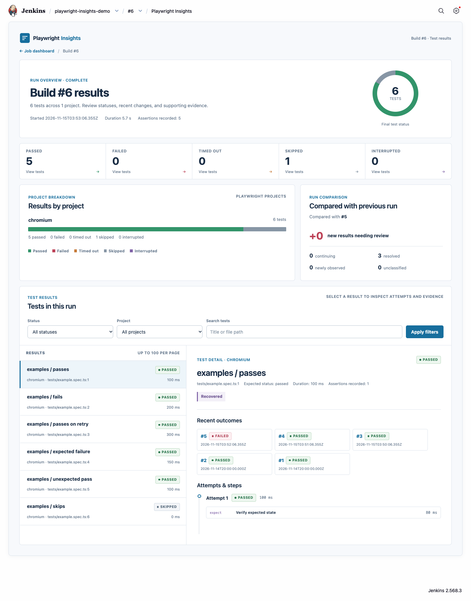
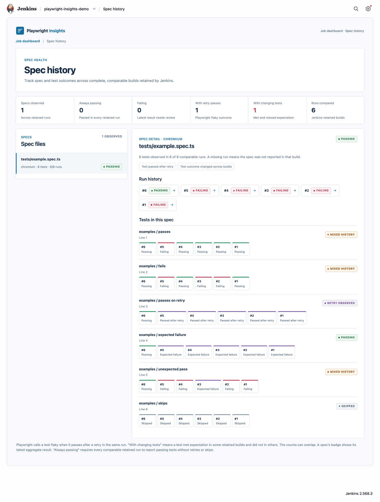
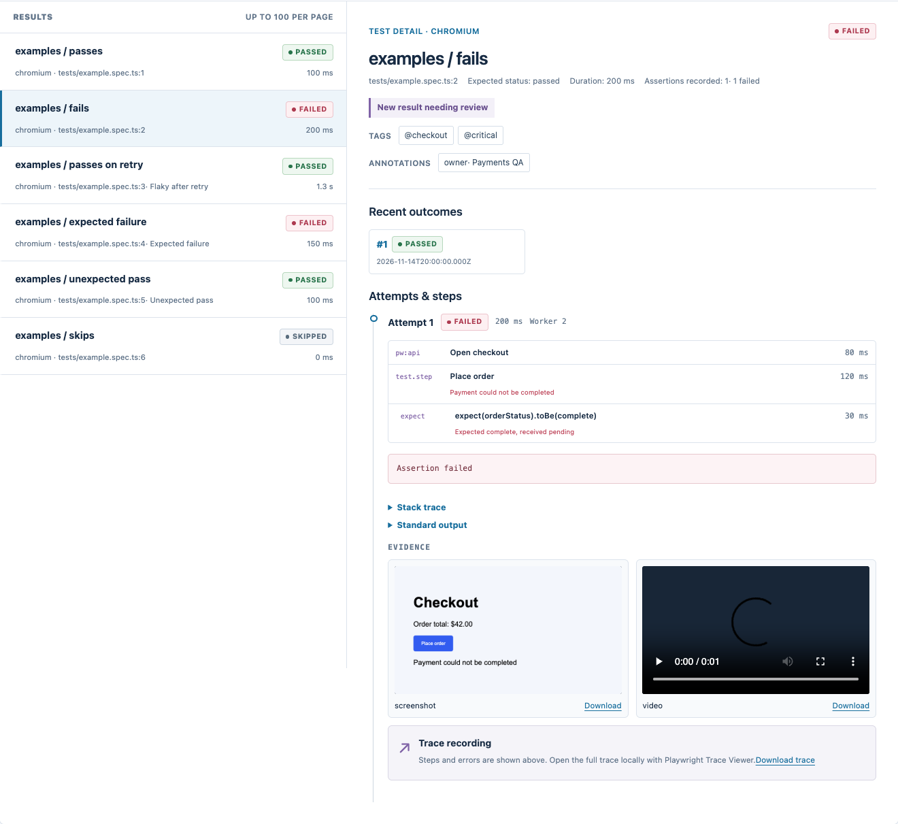

<h1> Playwright Insights for Jenkins</h1>

Playwright test results inside Jenkins, with run history, test details, and archived evidence in one place. The plugin imports Playwright's built-in JSON report after a Pipeline build and adds **Playwright Insights** to the job and build pages. No extra reporter package is required in your test suite.


## What you can inspect

- **Job dashboard:** recent runs, test counts, elapsed time, recorded assertions, the share of tests needing review, and spec health KPIs.
- **Spec history:** open **Explore spec and test history** from the job dashboard to see each spec file's health, outcomes across retained builds, and test-level history with links to build details.
- **Build results:** final Passed, Failed, Timed out, Skipped, and Interrupted statuses; project breakdown; and changes from the previous comparable run.
- **Test details:** search and filter results, review earlier outcomes, retries, available Playwright steps, failures, output, and annotations.
- **Evidence:** view archived screenshots and videos inline. Trace steps and errors appear in the test detail; download the trace archive to open the full Playwright Trace Viewer locally.

### Build results



### Spec and test history



### Test evidence



These screenshots come from the local six-run demo. The sample results and timestamps are illustrative.

## Install from source

The plugin is not published yet. You need JDK 21 and Maven to build it. The plugin targets Jenkins 2.568.3 with Pipeline support and has been tested with Playwright Test 1.64.x.

1. Build the plugin from this repository:

   ```sh
   mvn verify
   ```

2. In Jenkins, go to **Manage Jenkins → Plugins → Advanced**, upload `target/playwright-insights.hpi` under **Deploy Plugin**, and restart the controller. This follows the [Jenkins manual plugin installation guide](https://www.jenkins.io/doc/book/managing/plugins/#from-the-web-ui).

For a local preview without installing into an existing controller, run `mvn hpi:run -Dport=8092` from this repository and open `http://localhost:8092/jenkins/`.

## Configure Playwright and Jenkins

Enable Playwright's built-in JSON reporter in your project's `playwright.config.ts`:

```ts
import { defineConfig } from '@playwright/test';

export default defineConfig({
  reporter: [
    ['list'],
    ['json', { outputFile: 'playwright-insights/results.json' }],
    ['blob', { outputFile: 'playwright-insights/results.zip' }]
  ],
  use: {
    screenshot: 'only-on-failure',
    video: 'retain-on-failure',
    trace: 'retain-on-failure'
  }
});
```

Add a `Jenkinsfile` to that project. The test command and import step must use the same workspace; archive both built-in reports and Playwright attachments so evidence appears in Jenkins:

```groovy
pipeline {
  agent any
  options { buildDiscarder(logRotator(numToKeepStr: '20')) }
  stages {
    stage('Playwright') {
      steps {
        sh 'npm ci'
        sh 'npx playwright test'
      }
    }
  }
  post {
    always {
      playwrightInsights results: 'playwright-insights/results.json',
                         blob: 'playwright-insights/results.zip',
                         comparisonKey: 'my-complete-suite'
      archiveArtifacts artifacts: 'playwright-insights/results.json,playwright-insights/results.zip,test-results/**/*',
                       allowEmptyArchive: true
    }
  }
}
```

Open **Playwright Insights** on the Jenkins job for run history, or on a build for its test results. The blob report supplies `expect()` steps and assertion counts; the JSON report supplies results and attachments. `comparisonKey` groups equivalent full-suite runs for comparisons; use a different key for filtered runs or omit it. See the [local quickstart](docs/QUICKSTART.md) for import behavior, evidence handling, and limitations. The [manifest contract](schema/README.md) describes the plugin's internal snapshot format.

Spec history uses all complete, comparable builds that Jenkins still retains. The Pipeline `buildDiscarder` option in the example keeps the last 20 builds; once Jenkins discards a build, its history no longer appears. The dashboard's **Retry-flaky tests** KPI counts Playwright tests that passed after a retry in the latest run. The spec page separately counts spec files containing a retry pass and spec files containing a test that both met and missed expectation across retained builds. These counts can overlap; Playwright does not assign a flaky status to a spec file. A spec is **Always passing** only when every retained comparable run reports passing tests without retries or skips.

## Project status

The Jenkins plugin is prepared for public hosting but is not yet released to the Jenkins Update Center. The separate reporter in this repository remains available for richer API step detail and literal redaction, but is optional. See the [publishing checklist](docs/PUBLISHING.md) for the remaining steps.

Licensed under [MIT](LICENSE).
